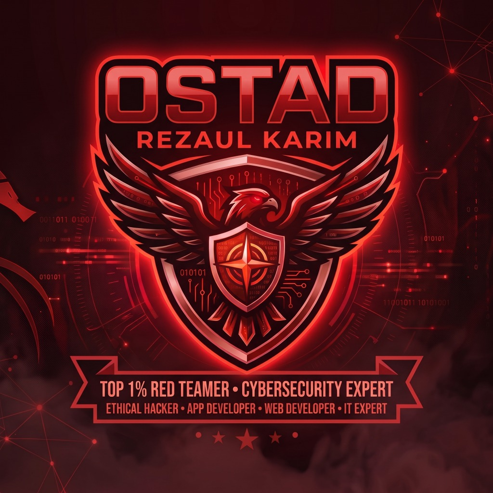

# Ostad EveLogExp 🛡️
### Advanced Windows Event Log Forensics & Threat Hunting Platform
#### Official Security & Incident Response Tool by Ostad Red Team Forge

<p align="center">
  
</p>

<p align="center">
  <a href="#-key-capabilities"></a>
  <a href="#-mitre-attck-matrix-coverage"></a>
  <a href="#-architecture--engine"></a>
  <a href="#-ostad-red-team-forge"></a>
</p>

---

## 🦅 About Ostad Red Team Forge

**Ostad Red Team Forge** is a premier cybersecurity research, elite adversary simulation, and defensive digital forensics collective founded by **Ostad Rezaul Karim**. 

> **Founder & Director:** **Ostad Rezaul Karim**  
> **Global Ranking & Profile:** **Top 1% Red Teamer • Cybersecurity Expert**  
> **Core Disciplines:** Advanced Penetration Testing • Ethical Hacking • Exploit & Tool Engineering • DFIR • Threat Intelligence  

**Ostad EveLogExp** was engineered specifically to overcome the severe limitations of standard Windows Event Viewer (`eventvwr.msc`) and deliver an enterprise-grade, high-performance tactical workbench for Security Operation Centers (SOC), incident responders, and offensive red team operators.

---

## ⚡ Why Ostad EveLogExp? (The Enterprise Advantage)

Traditional event viewing tools are notoriously slow, freeze on multi-gigabyte log files, lack multi-machine chronological merging, and fail when encountering damaged `.evtx` files during real-world cyber incidents. Commercial forensic tools with these capabilities often cost between **$209 to $529+ per license**.

**Ostad EveLogExp** delivers full forensic capabilities in a lightweight, blisteringly fast, analyst-centric desktop suite.

```
┌───────────────────────────────────────┬──────────────────────┬────────────────────────┬─────────────────────────┐
│ Feature / Capability                  │ Windows Event Viewer │ Typical Free Viewers   │ Ostad EveLogExp         │
├───────────────────────────────────────┼──────────────────────┼────────────────────────┼─────────────────────────┤
│ Multi-Server / Multi-Channel Merger   │ ❌ Impossible        │ ❌ Single Source Only   │ ✔️ Native Unified Stream │
│ Reusable Threat Investigation Tasks   │ ❌ None              │ ❌ Filter Only         │ ✔️ Pre-built Templates  │
│ Forensic Deep Scan on Damaged EVTX    │ ❌ Fails / Crashes   │ ❌ Corrupt Data Refusal│ ✔️ Robust Chunk Recovery│
│ Real-Time Incident Alerter & Beep     │ ❌ No Auto-Alert     │ ❌ Static Polling Only │ ✔️ Instant Audio Alarm  │
│ Analyst-Controlled AI Copilot         │ ❌ None              │ ❌ None                │ ✔️ Integrated Assistant │
│ High-Speed Virtualized Grid (100k+)   │ ⚠️ Notoriously Slow  │ ⚠️ Memory Heavy        │ ⚡ Instant Microsecond UI│
│ Standalone Interactive HTML Reports   │ ❌ Primitive TXT/CSV │ ⚠️ Basic Text Dump     │ 📊 Styled Responsive Web│
└───────────────────────────────────────┴──────────────────────┴────────────────────────┴─────────────────────────┘
```

---

## 🎯 Tactical Use Cases (Red Team & Blue Team)

### 🔴 Red Team & Threat Emulation
* **Log Evasion Verification:** Verify if defense-evasion techniques (such as event log clearing or telemetry disabling) generate detectable footprints (`Event ID 1102`, `104`).
* **Telemetry Gap Identification:** Discover which audit policies and Sysmon rules are active on the target endpoint.
* **Credential Movement Auditing:** Trace lateral movement footprints, RDP reconnections, and Pass-the-Hash artifacts across multiple endpoints.

### 🔵 Blue Team, SOC & Incident Response
* **RDP Brute-Force & Lateral Movement Triage:** Instantly execute pre-configured tasks for `Event ID 4624` (Logon Type 10) and `4625` to uncover unauthorized access.
* **Privilege Escalation Detection:** Spot anomalous group membership additions (`Event ID 4728`, `4732`, `4756`) and new service installations (`Event ID 7045`).
* **Post-Exploitation Anti-Forensics:** Detect security log tampering, clearing, and process masquerading in real time.
* **Forensic Disk Recovery:** Extract intact event records from damaged or unallocated VMDK/VHD/EVTX files during breach investigations.

---

## 🛠️ Key Capabilities & Features

### 1. Unified Multi-Source "Merger" Engine
Analyze events across multiple servers (`SRV001`, `SRV002`, `DomainController`) and channels (`Security`, `System`, `PowerShell`, `Sysmon`) in a single chronologically sequenced master investigation timeline.

### 2. Pre-Packaged Threat Investigation Templates
Pre-configured with industry-standard DFIR templates ready for single-click execution:
* **Audit RDP Logons:** Isolates remote desktop authentications and reconnection events.
* **Audit Failures & Brute Force:** Pinpoints brute-force spikes, password spraying, and lockout triggers.
* **Clear Event Log (Tamper Detection):** Flags `Event ID 1102` & `104` instantly.
* **User Account Management:** Audits password resets, account modifications, and account disablement.
* **New External Hardware (USB Forensics):** Uncovers unauthorized external storage device insertions.
* **Service Installation & Crash Analysis:** Identifies rogue persistence services and application crashes.

### 3. Signature Color-Coding Triage System
Visual triaging matching top forensic labs:
* ⛔ **Critical:** Dark Crimson `#7F0000`
* ❌ **Error:** Soft Coral `#FFD6D6`
* 🚫 **Audit Failure:** High-visibility Alert `#FFE0E6`
* ⚠️ **Warning:** Amber Highlight `#FFF3CD`
* 🔑 **Audit Success:** Verification Green `#E8F8F5`
* 🎨 **Custom Rule Builder:** Build unlimited custom color rules mapped to specific Event IDs, Providers, or Threat Keywords.

### 4. Split-Pane Deep Inspection
* **Description Tab:** Full human-readable messages formatted directly from publisher DLL metadata.
* **Data Tab:** Parameterized key-value `<EventData>` extractions for fast artifact extraction.
* **Raw XML:** One-click copyable raw event XML for SIEM ingest and Sigma rule authoring.

### 5. Built-In AI Copilot (Analyst-Controlled)
Equipped with an integrated AI Copilot assistant. The analyst chooses which event metadata to package into structured threat hypotheses, explain cryptic Microsoft return codes, and map incidents to remediation playbooks.

### 6. Multi-Format Forensic Exporter
Export filtered triage findings to:
* 🌐 **Interactive HTML Report:** Self-contained, responsive report with built-in client-side search and summary metrics.
* 📊 **Excel CSV & TSV:** Clean schema for pivot-table analysis.
* 🏷️ **JSON & XML:** Structured formats ready for pipeline forwarding.

---

## 🛡️ MITRE ATT&CK Matrix Coverage

| MITRE ATT&CK Technique | Tactic | Event IDs Audited | Ostad EveLogExp Template |
|---|---|---|---|
| **T1078 - Valid Accounts** | Initial Access / Defense Evasion | `4624`, `4625`, `4648` | `Audit logons` / `Audit interactive logons` |
| **T1021.001 - Remote Desktop Protocol** | Lateral Movement | `4624 (Type 10)`, `1149`, `21`, `25` | `Audit RDP logons` |
| **T1070.001 - Clear Windows Event Logs** | Defense Evasion | `1102`, `104` | `Clear event log` |
| **T1098 - Account Manipulation** | Persistence | `4720`, `4722`, `4724`, `4738` | `User account management` |
| **T1069 - Permission Groups Discovery** | Discovery / Privilege Escalation | `4728`, `4732`, `4756` | `Member added to group` |
| **T1543.003 - Windows Service** | Persistence / Privilege Escalation | `7045`, `7036` | `Service installation & crashes` |
| **T1200 - Hardware Additions** | Initial Access / Exfiltration | `20001`, `20003`, `10000` | `New external device` |

---

## 🚀 Quick Start Guide

### Option 1: Standalone Portable Binary (No Installation Required)
Launch the pre-compiled high-performance Windows binary directly:
```
dist\OstadEveLogExp\OstadEveLogExp.exe
```

### Option 2: Run via Source (Python 3.10+)
```powershell
# Clone or navigate to the repository
cd EventLogExplorer

# Run the application launcher
run.bat
# OR execute directly:
python main.py
```

### Option 3: Compile into Standalone Binary
```powershell
build_exe.bat
```

---

## ⌨️ Tactical Hotkeys

| Shortcut | Action |
|---|---|
| `Ctrl + O` | Open External `.evtx` / `.evt` Forensic File |
| `Ctrl + S` | Export Active Triage Findings (HTML, CSV, JSON, XML) |
| `Ctrl + L` | Open Multi-Condition Filter Builder |
| `Ctrl + K` | Open Color-Coding Scheme Configurator |
| `Ctrl + T` | Open Statistics & Frequency Triage Dashboard |
| `F4` | Toggle Objects Tree Navigation Sidebar |
| `F5` | Reload / Live Poll Active Channel |
| `F6` | Toggle Description & Data Inspection Pane |
| `Enter` / `Double Click` | Open Detailed Event Properties Inspector |

---

## 🏛️ Project Governance & Community

* **Organization:** [Ostad Red Team Forge](https://github.com/OstadRezaulKarimRedTeamer)
* **Lead Architect:** **Ostad Rezaul Karim**
* **Inquiries & Training:** Official Red Team Forge Community Channels
* **License:** Licensed under the MIT License - Free for Educational, Research, and Professional DFIR use.

<p align="center">
  <strong>Ostad EveLogExp • Built by Red Teamers, for Cyber Defenders Worldwide.</strong>
</p>
